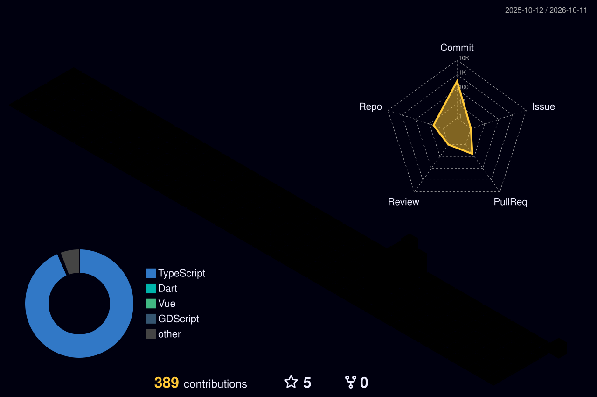

<h1 align="center">Olá, eu sou bnd.sants 👋</h1>
<h3 align="center">Bernardo Santos · Desenvolvimento full stack e mobile</h3>

  🎓 Formado em <b>Análise e Desenvolvimento de Sistemas</b> e estudante de <b>Ciência da Computação</b>.
  Desenvolvo aplicações web e mobile, com interesse em experiência do usuário e segurança da informação.

---

### 🛠️ Tecnologias que uso nos projetos

  
  
  
  
  
  
  

---

### 🚀 Projetos em destaque

| Projeto | O que é | Tecnologias |
| --- | --- | --- |
| [🍎 Desperdício Zero](https://github.com/bnd-sants/desperdicio_zero-master) | Aplicativo para ajudar a reduzir o desperdício de alimentos, com cadastro de produtos, alertas de validade e sugestões de receitas. | Flutter, Dart, Supabase |
| [🖥️ NÚCLEO](https://github.com/bnd-sants/tech-gamer-ecommerce) | Conceito de e-commerce de componentes para PC, com catálogo, comparador, montador de setup e fluxo de compra demonstrativo. | Vue 3, TypeScript, Vite |
| [🏢 Gravity SaaS](https://github.com/bnd-sants/SaaS-Multi-tenant) | Base para aplicações SaaS multilocatárias, com autenticação, permissões por função e gestão de organizações. | Next.js, TypeScript, PostgreSQL |

---

### ⚡ Sobre mim

- 📍 Belém do Pará, Brasil.
- 💼 Atuo como freelancer em desenvolvimento de software e automação.
- 🔐 Tenho interesse em segurança da informação e sigo estudando o tema.
- 🛹 Fora das telas, gosto de calistenia, skate, setups de PC e dos meus agapornis.

---

### 📊 GitHub

  
  

  

---

### 📫 Contato

  <a href="mailto:bernardoneto88@gmail.com">E-mail</a> ·
  <a href="https://www.linkedin.com/in/bernardo-santos-a54519169/">LinkedIn</a>

